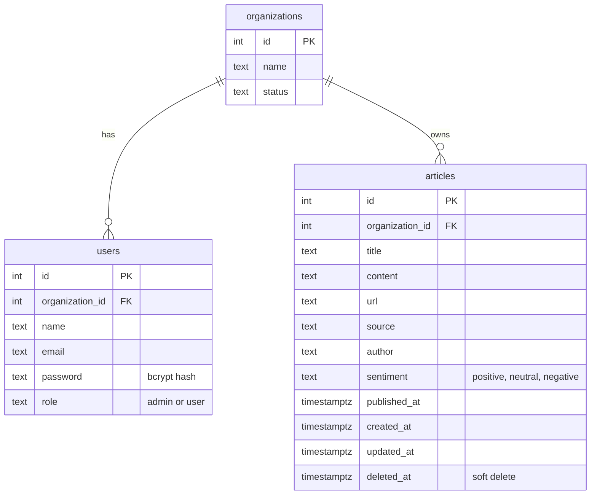
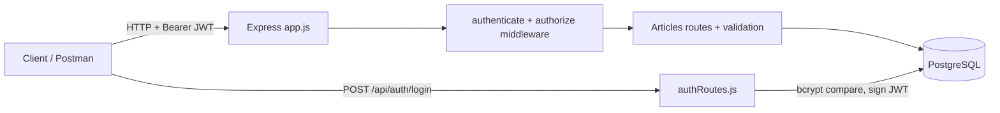

# Digivla Media Monitoring - Articles API

Articles API for a **Media Intelligence Monitoring** platform. It is multi-tenant: every organization can only see and manage its own articles.

Built for Digivla Case Study, Question 1 (with performance notes for Question 2).

## Deliverables

| Deliverable | Where |
| --- | --- |
| Database migration / schema | [`schema.sql`](schema.sql), seed data in [`seed.sql`](seed.sql) |
| ERD | [ERD](#erd), source in [`schema.dbml`](schema.dbml) |
| API documentation | [Endpoints](#endpoints) and the Postman collection in `postman/` |
| Automated tests | Postman collection tests, see [Automated tests](#api-documentation-and-automated-tests) |
| Architecture diagram | [Architecture](#architecture) |
| Endpoint list | [Endpoints](#endpoints) |

## Tech stack

- Node.js, Express (CommonJS)
- PostgreSQL via `pg`
- `bcrypt` for password hashing, `jsonwebtoken` for JWT
- Postman for API documentation and automated tests

## Project structure

```
.
├── app.js                    # Express app: all /api/articles routes, validateArticle, parseId
├── db.js                     # PostgreSQL connection (pg)
├── src/
│   ├── middleware/
│   │   └── auth.js           # authenticate and authorize
│   └── routes/
│       └── authRoutes.js     # POST /api/auth/login
├── schema.sql                # tables and indexes
├── seed.sql                  # development seed data
├── schema.dbml               # ERD source for dbdiagram.io
├── postman/                  # Postman collection export (TODO)
├── .env.example              # copy to .env (.env is not committed)
└── package.json
```

## Getting started

Requirements: Node.js and PostgreSQL.

```bash
npm install
cp .env.example .env          # then fill in the values
psql -f schema.sql            # TODO: add the connection flags / database name
psql -f seed.sql
npm start                     # or: node app.js (TODO: check the npm script)
```

The server listens on port **3000**.

### Environment variables

| Variable | Description |
| --- | --- |
| `JWT_SECRET` | Secret used to sign and verify JWTs |
| TODO | Database connection variables used in `db.js` (e.g. `DATABASE_URL` or `PGHOST`, `PGUSER`, `PGPASSWORD`, `PGDATABASE`, `PGPORT`) |

## Database schema

### organizations

TODO: check the full column list.

| Column | Notes |
| --- | --- |
| `id` | primary key |
| `name` | |
| `status` | e.g. active |

### users

TODO: check the full column list.

| Column | Notes |
| --- | --- |
| `id` | primary key |
| `organization_id` | FK to `organizations(id)` |
| `name` | |
| `email` | |
| `password` | bcrypt hash |
| `role` | `admin` or `user` |

### articles

| Column | Type | Constraints |
| --- | --- | --- |
| `id` | `SERIAL` | primary key |
| `organization_id` | `INT` | `NOT NULL`, FK to `organizations(id)` |
| `title` | `TEXT` | `NOT NULL` |
| `content` | `TEXT` | `NOT NULL` |
| `url` | `TEXT` | |
| `source` | `TEXT` | `NOT NULL` |
| `author` | `TEXT` | |
| `sentiment` | `TEXT` | `NOT NULL`, `CHECK (sentiment IN ('positive','neutral','negative'))` |
| `published_at` | `TIMESTAMPTZ` | `NOT NULL` |
| `created_at` | `TIMESTAMPTZ` | `NOT NULL DEFAULT now()` |
| `updated_at` | `TIMESTAMPTZ` | `NOT NULL DEFAULT now()` |
| `deleted_at` | `TIMESTAMPTZ` | soft delete marker |

Index:

```sql
CREATE INDEX idx_articles_org_sentiment_source_published
  ON articles (organization_id, sentiment, source, published_at DESC, id DESC)
  WHERE deleted_at IS NULL;
```

Relations: one organization has many users, and one organization has many articles.

## ERD

The source is [`schema.dbml`](schema.dbml), which can be opened at [dbdiagram.io](https://dbdiagram.io).



## Architecture



## Authentication and authorization

- `POST /api/auth/login` returns a JWT. Payload: `id`, `organization_id`, `role`.
- Every `/api/articles` request needs the header `Authorization: Bearer <token>`.
- `organization_id` always comes from the token, never from the request body.
- `POST`, `PUT` and `DELETE` are admin only (`authorize('admin')`). The `user` role is read only.
- An article that belongs to another organization returns `404`, so the API does not reveal that it exists.

### Seed accounts (development only)

| Account | Organization | Role | Password |
| --- | --- | --- | --- |
| admin1 | 1 | admin | `password123` |
| user1 | 1 | user | `password123` |
| admin2 | 2 | admin | `password123` |

TODO: check the login field (username or email) and the exact values.

## Endpoints

| Method | Path | Description | Success | Access |
| --- | --- | --- | --- | --- |
| POST | `/api/auth/login` | Log in and get a JWT | 200 | Public |
| GET | `/api/articles` | List with pagination, search, filters and sorting | 200 | All roles |
| GET | `/api/articles/:id` | Article detail | 200 | All roles |
| POST | `/api/articles` | Create an article | 201 | Admin |
| PUT | `/api/articles/:id` | Full replace (all fields required) | 200 | Admin |
| DELETE | `/api/articles/:id` | Soft delete | 204 | Admin |

### Query parameters for `GET /api/articles`

| Parameter | Description |
| --- | --- |
| `page` | Default 1, minimum 1 |
| `limit` | Default 10, maximum 100 |
| `search` | `ILIKE` on `title` or `content` |
| `sentiment` | Exact match, case-insensitive (input is normalized to lowercase) |
| `source` | Exact match, case-insensitive (input is normalized to lowercase) |
| `startPublish`, `endPublish` | Range on `published_at` |
| `sortBy` | Whitelist: `published_at`, `created_at`, `updated_at`, `title`, `source` (default `published_at`) |
| `order` | `asc` or `desc` (default `desc`), tiebreaker `id DESC` |

All values go through parameterized queries, so user input never ends up in the SQL text.

Example:

```
GET /api/articles?page=1&limit=20&sentiment=NEGATIVE&source=kompas.com
```

### Response format

List:

```json
{
  "data": [],
  "pagination": {
    "page": 1,
    "limit": 20,
    "totalItems": 0,
    "totalPages": 0,
    "hasNextPage": false,
    "hasPrevPage": false
  }
}
```

Detail, create and update:

```json
{ "data": {} }
```

Error:

```json
{ "error": "message" }
```

Validation error:

```json
{ "error": "Validation failed", "details": ["title is required"] }
```

A `500` is always `{ "error": "Internal server error" }`. Error details only go to the server log.

### Validation

`validateArticle` runs on `POST` and `PUT`:

- `title`, `content`, `source`, `sentiment` and `published_at` are required.
- Strings are trimmed. `source` and `sentiment` are normalized to lowercase.
- `sentiment` must be `positive`, `neutral` or `negative`.
- `published_at` must be a valid date.
- `url` and `author` are optional (stored as `null`).
- TODO: `url` format is not validated yet.

`parseId` validates the `:id` in the URL: it must be a positive integer up to 2^31 - 1, otherwise the API returns `400` with `"Invalid article id"`.

### Status codes

| Code | When |
| --- | --- |
| 200 | OK |
| 201 | Article created |
| 204 | Article deleted |
| 400 | Validation failed or invalid id |
| 401 | Missing or invalid token |
| 403 | Not an admin |
| 404 | Not found, or belongs to another organization |
| 500 | Internal server error |

## Soft delete

`DELETE` sets `deleted_at = NOW()` instead of removing the row, and every query filters on `deleted_at IS NULL`.

Why:

- Deleted data can be restored.
- It leaves an audit trail.
- Historical data stays available for media monitoring analysis.

## API documentation and automated tests

The Postman collection **Articles API** documents every endpoint and carries the automated tests. TODO: export it to `postman/`.

Run it with the Postman Collection Runner, or with newman:

```bash
npx newman run postman/<collection>.json   # TODO: file name
```

Each request sets its own `Authorization` header with a per-account token (`tokenAdmin1`, and so on), so a sequential run never overwrites another account's token.

Covered:

- Login
- List articles
- List from another organization (empty `data`, `totalItems` 0)
- Article detail
- Detail from another organization (404)
- Detail not found (404)
- Create article (201)
- Create with invalid sentiment (400)
- Create with null sentiment (400)
- Update article
- Update without title (400 with `details`)
- Delete (204)
- Delete not found (404)

Not covered yet (TODO):

- 401 without a token
- 403 when a `user` calls `POST`
- Duplicate article prevention

## Performance notes (Question 2)

Target query, on 5 million articles:

```
GET /api/articles?sentiment=NEGATIVE&source=kompas.com&page=1&limit=50
```

Investigation with `EXPLAIN ANALYZE`:

- Without an index, the plan is Seq Scan, then Sort, then Limit.
- With the composite partial index above (tested with `SET enable_seqscan = off` on a small dataset), it becomes an Index Scan and the Sort step disappears, because the index already returns rows in `published_at DESC, id DESC` order.
- `sentiment` and `source` are filtered with `=` on lowercase-normalized data (not `ILIKE`), so the B-tree index can be used.

Next steps:

- The cost of `COUNT(*)` for `totalItems` on large result sets
- Keyset pagination for deep pages
- `pg_trgm` or full-text search (GIN) for `search`
- Caching

## Roadmap

- Rewrite in TypeScript
- Validate the `url` format
- Duplicate prevention: a unique constraint such as `(organization_id, url)`, returning `409`
- Reject login when the organization is not active
